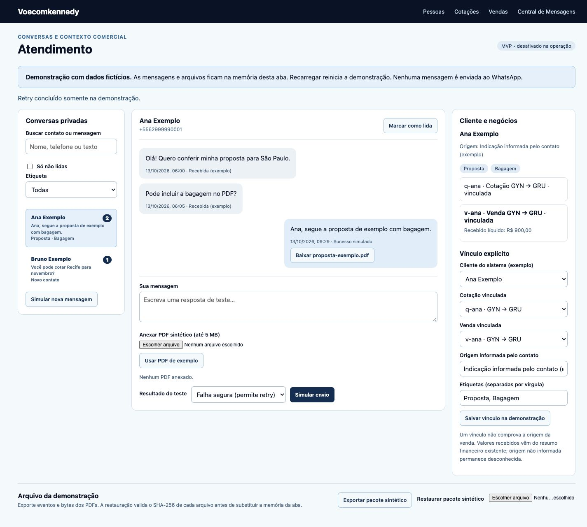

# Validação do incremento 1 — 13/10/2026

Executada no Mac mini, checkout externo e dados sintéticos. Não acessou banco operacional, credenciais Z-API, conversas pessoais ou envio real.

| Verificação final | Resultado |
| --- | --- |
| `npm test` — painel e regressões comerciais | 123/123 passaram; inclui 20 testes novos do domínio/adaptadores/UI/handler |
| `npm --prefix cotador test` | 50/50 passaram |
| Deno — Central e candidato pós-venda | 75/75 passaram, `--cached-only`, sem permissões |
| `npm run test:db` — Central existente | 16/16 passaram em PostgreSQL 17 descartável |
| `npm run test:atendimento:db` | 7/7 passaram: RLS, FKs, deduplicação, concorrência, retry/incerto, bucket privado |
| Deno lint — incremento | 7 arquivos passaram |
| Deno lint — Central existente | 11 arquivos passaram |
| Deno check — entrypoint existente Central | Passou |
| Node `--check` — módulos novos e runner do banco | Passou |
| Git whitespace/diff | `git diff --check` passou; somente package.json alterado entre arquivos preexistentes |
| Fonte pós-venda v9 | SHA-256 idêntico à base: `24abc67772e29404e8436202db756b392c674c9beccc2dc6a7ee084d6acf3864` |

Total: 271 testes finais passaram, sem falhas finais ou testes pulados nas suítes executadas. Na primeira execução, um teste novo falhou porque a fixture VM não fornecia `window` exigido por storage.js; a fixture foi corrigida e a suíte completa passou. Uma corrida no teste DOM esperava apenas dois ciclos do event loop para o checksum do PDF; foi corrigida para esperar a conclusão visível da ação. Quatro apontamentos de lint novos foram corrigidos. Não houve falha final das suítes antigas.

No navegador local, confirmado: abertura da demo, duas conversas, valor recebido líquido de R$ 900, composição de texto + PDF sintético, falha segura, retry da mesma mensagem com sucesso simulado, download nativo do PDF e pacote JSON, restauração nativa do pacote com bytes preservados. Capturas desktop em viewport 1440×1000 e móvel em 390×844. No móvel, `scrollWidth` e `clientWidth` iguais (375 px de conteúdo, com scrollbar), sem overflow horizontal.

[Móvel, captura completa](evidencias/mobile.png).

Não rodados: homologação HTTP/Auth/Storage real Supabase, deploy, envio/entrega Z-API, ingresso autenticado e filas duráveis, cópia/restauração real dos objetos em nuvem e sincronização entre aparelhos. Build/typecheck completo JS não existem na configuração atual. O Deno check de `.mjs` sem checkJs não equivale a tipagem completa. `pdfinfo` não está instalado; o download nativo foi confirmado, mas não alegamos validação/renderização PDF por Poppler.

Os resumos finais de execução foram preservados junto desta entrega em `logs/`, sem dados reais. Os clusters descartáveis foram encerrados e removidos pelos seus runners; nenhum serviço de banco foi criado.
